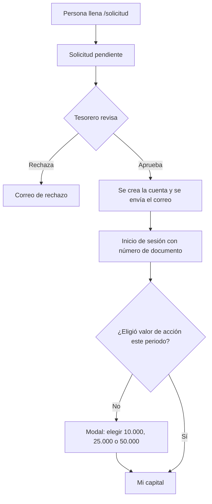
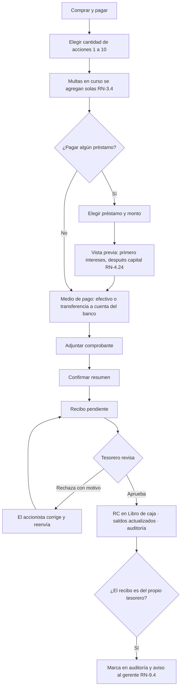
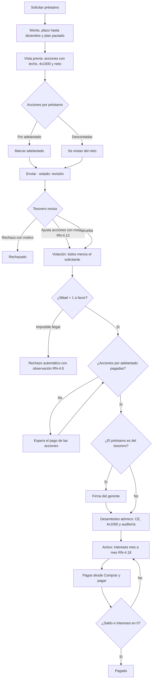
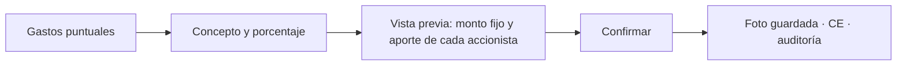
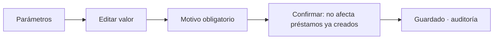
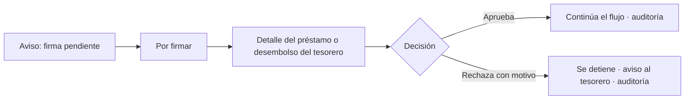
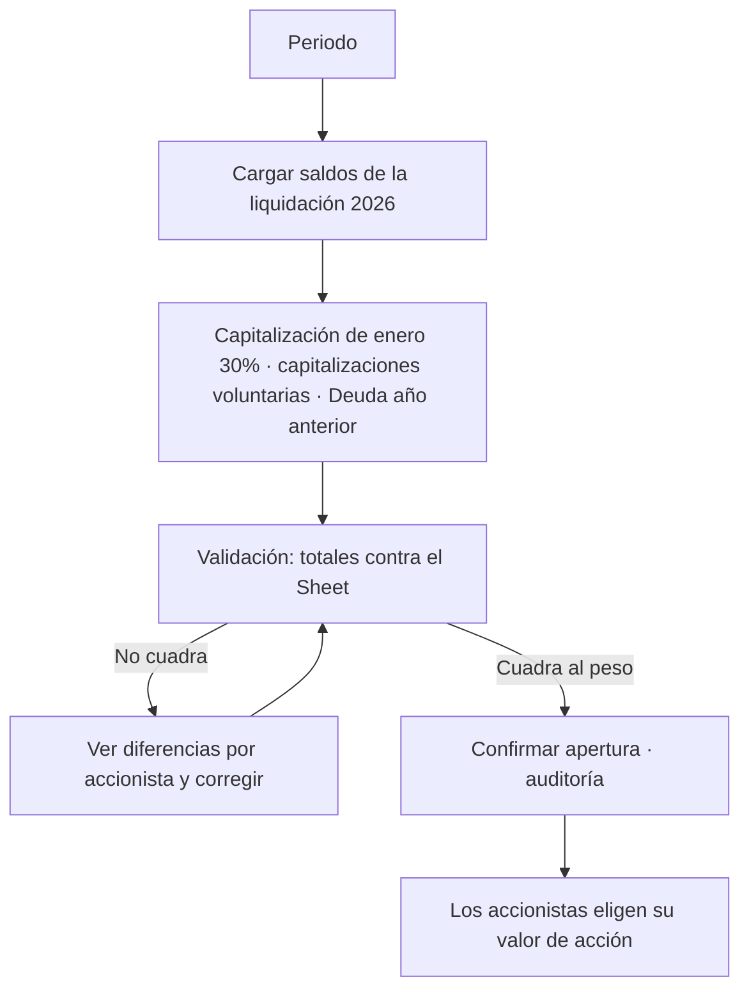
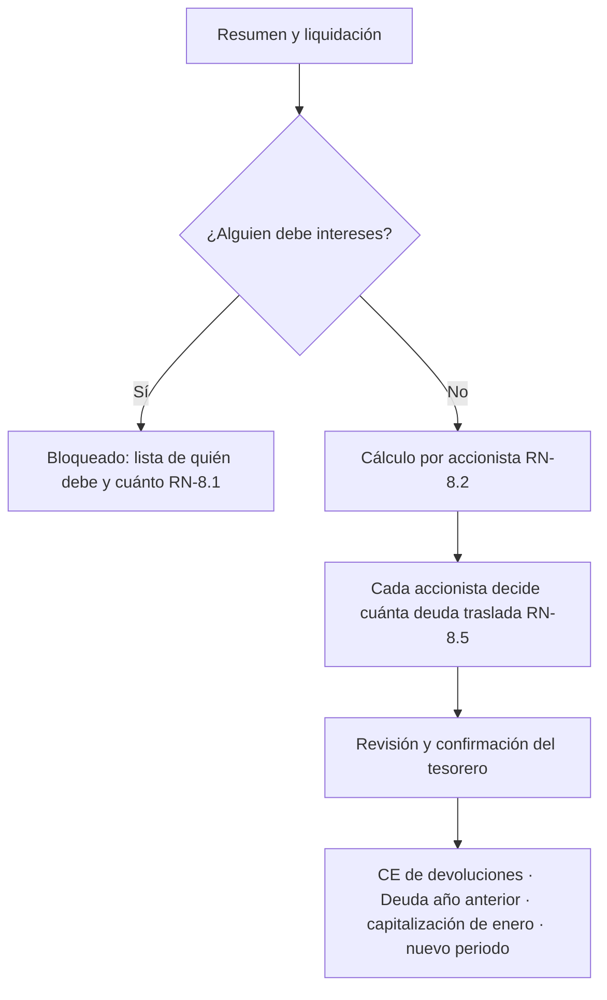

# AppFlow: Ahorro Familiar

> Este documento describe **qué pantallas tiene la app, quién las ve y cómo se navega** en cada flujo.
> Las reglas que cita (RN-x.y) están en [reglas-negocio.md](./reglas-negocio.md).
>
> **Versión:** 0.1 · **Fecha:** 2026-10-14
> **Leyenda de estado:** 🟢 existe y se mantiene · 🟡 existe y cambia · 🔵 nueva · ⚪ fase 2

---

## 1. Navegación

### 1.1 Un menú, dos secciones
Como **todo usuario es accionista** y algunos además administran, el menú deja de cambiar según un rol único y pasa a tener **dos secciones**:

```
┌──────────────────────────┐
│  MI CUENTA               │  ← todos
│   Mi capital             │
│   Comprar y pagar        │
│   Préstamos              │
│   Historial              │
│   Extracto               │
│   Ajustes                │
├──────────────────────────┤
│  ADMINISTRACIÓN          │  ← solo gerente y tesorero
│   Inicio admin           │
│   Por firmar  (gerente)  │
│   Solicitudes de ingreso │
│   Accionistas            │
│   Préstamos              │
│   Libro de caja          │
│   Libro de accionista    │
│   Extractos              │
│   Gastos puntuales (T)   │
│   Parámetros (T)         │
│   Auditoría              │
│   Periodo                │
└──────────────────────────┘
(T) = solo tesorero; el gerente lo ve en modo lectura o no lo ve.
```

- **Celular:** barra inferior con las 4 entradas principales de "Mi cuenta" (Mi capital, Comprar, Préstamos, Más). La sección de administración se abre desde "Más".
- **Escritorio:** menú lateral con las dos secciones.

### 1.2 Pendientes (campana)
La app ya tiene un panel de pendientes, que se mantiene y amplía:

| Para | Pendiente |
|---|---|
| Accionista | Préstamos esperando tu voto · recibos por reenviar · acciones por préstamo por pagar · préstamos desembolsados · **multa en curso** 🔵 |
| Tesorero | Solicitudes de ingreso · recibos por aprobar · préstamos en revisión · préstamos por desembolsar |
| Gerente | 🔵 **Firmas pendientes** (préstamos y desembolsos del tesorero) · 🔵 **avisos** de recibos propios del tesorero |

---

## 2. Inventario de pantallas

### 2.1 Públicas
| Ruta | Pantalla | Estado |
|---|---|---|
| `/` | Inicio | 🟢 |
| `/login` | Inicio de sesión con número de documento | 🟢 |
| `/forgot-password`, `/update-password` | Recuperación de contraseña | 🟢 |
| `/verify-email-change` | Confirmación de cambio de correo | 🟢 |
| `/solicitud`, `/solicitud/confirmacion` | Solicitud de ingreso al banco | 🟢 |

### 2.2 Mi cuenta (todos)
| Ruta | Pantalla | Estado | Cambio |
|---|---|---|---|
| `/dashboard/accionista` | **Mi capital:** acciones, capitalizaciones, utilidades, deuda y multa en curso | 🟡 | Datos desde casos de uso del servidor, no calculados en el cliente |
| *(modal)* | **Elegir valor de acción del periodo** | 🔵 | Bloquea la compra hasta elegir (RN-2.3) |
| `/dashboard/compras` | **Comprar y pagar:** acciones, multas y pagos a préstamos en un solo recibo | 🟡 | Intereses primero y abonos parciales (RN-4.24 y 4.25) |
| `/dashboard/prestamos` | Mis préstamos: saldo, intereses, cuota pactada y estado | 🟡 | |
| `/dashboard/prestamos/nueva` | Solicitar préstamo, con vista previa del neto | 🟡 | Plazo hasta diciembre, acciones con techo y sin mínimo (RN-4) |
| `/dashboard/prestamos/[id]` | Detalle del préstamo: plan, pagos y votación | 🟡 | |
| `/dashboard/prestamos/votar` | Préstamos por votar | 🟡 | Sin el solicitante y con rechazo automático (RN-4.6 a 4.8) |
| `/dashboard/historial` | Mis recibos y su estado | 🟢 | |
| `/dashboard/extracto` | Extracto del periodo | 🟡 | Utilidades calculadas en el dominio |
| `/dashboard/ajustes` | Perfil, cuentas bancarias y correo | 🟡 | Los parámetros del sistema salen de aquí a su propia pantalla |

### 2.3 Administración (gerente y tesorero)
| Ruta | Pantalla | Quién | Estado | Cambio |
|---|---|---|---|---|
| `/dashboard/admin` | Inicio admin: caja, pendientes e indicadores | G, T | 🟡 | |
| `/dashboard/admin/firmas` | **Por firmar:** aprobar o rechazar lo propio del tesorero | G | 🔵 | RN-9.4 |
| `/dashboard/solicitudes` | Solicitudes de ingreso | T (G lee) | 🟢 | |
| `/dashboard/miembros` | Accionistas | T (G lee) | 🟡 | Asignar `admin_role` |
| `/dashboard/admin/prestamos` | Préstamos: revisión, votación y desembolso | T (G lee) | 🟡 | Excepción de acciones con motivo y desembolso atómico |
| `/dashboard/admin/prestamos/[id]` | Detalle y acciones del préstamo | T (G lee) | 🟡 | Saldo, cuota pactada y cuota para cerrar el año |
| `/dashboard/libro-caja` | Libro de caja: aprobar, rechazar y anular recibos | T (G lee) | 🟡 | Anulación con motivo, sin borrar |
| `/dashboard/admin/libro-accionista` | Libro por accionista | G, T | 🟢 | |
| `/dashboard/admin/extractos` | Extractos de todos | G, T | 🟢 | |
| `/dashboard/admin/gastos` | **Gastos puntuales** | T (G lee) | 🔵 | RN-7.2 |
| `/dashboard/admin/parametros` | **Parámetros ⚙️** | T (G lee) | 🔵 | Antes estaba en Ajustes |
| `/dashboard/admin/auditoria` | **Auditoría:** filtrable por actor, entidad y fecha | G, T | 🔵 | RN-9 |
| `/dashboard/admin/periodo` | **Periodo:** apertura e importación de saldos iniciales | T | 🔵 | F1.6 |
| `/dashboard/admin/resumen` | Resumen y **liquidación** | G, T | ⚪ | Fase 2: liquidación en el servidor |

---

## 3. Flujos

### 3.1 Ingreso y primer uso


### 3.2 Comprar acciones y pagar préstamos (un solo recibo)


### 3.3 Préstamo: de la solicitud al pago


### 3.4 Gasto puntual (tesorero)


### 3.5 Cambio de parámetros (tesorero)


### 3.6 Firma del gerente


### 3.7 Apertura del periodo 2027 (una sola vez, en enero)


### 3.8 Liquidación (fase 2) ⚪


---

## 4. Principios de navegación
- **Máximo 3 toques** para las tareas frecuentes: pagar acciones, ver mi deuda y votar.
- **Antes de cualquier acción de dinero**, una pantalla de **confirmación con el resumen** de lo que va a pasar.
- **Toda pantalla administrativa** muestra claramente si el usuario está en modo lectura (gerente).
- Después de cada acción, mostrar **el resultado y el siguiente paso**, por ejemplo: "Recibo enviado. El tesorero lo revisará".
