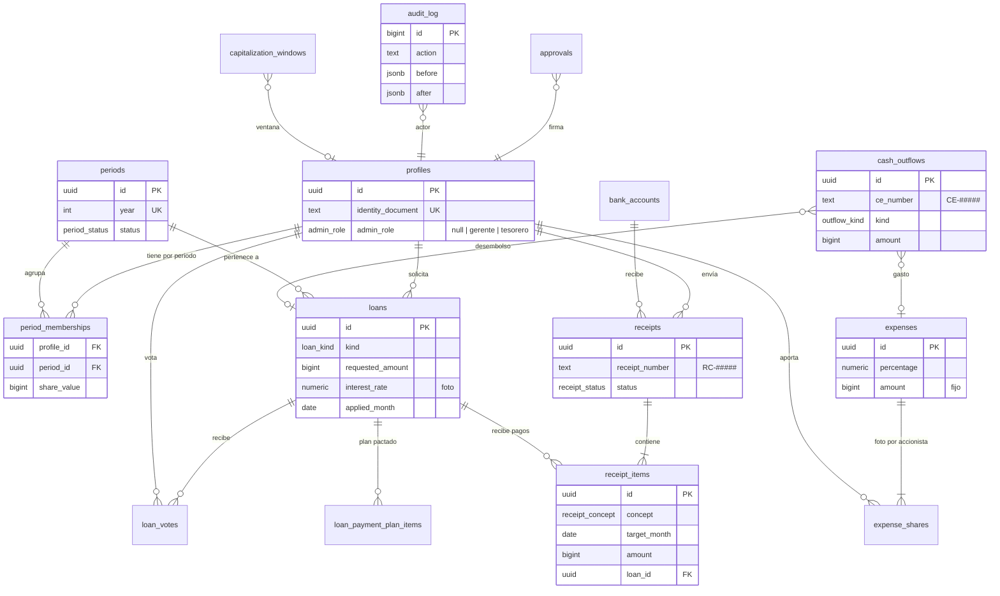

# Backend Schema: Ahorro Familiar

> Modelo de datos en Supabase (Postgres): **qué existe hoy** y **cómo debe quedar** para cumplir [reglas-negocio.md](./reglas-negocio.md) y [arquitectura.md](./arquitectura.md).
> El esquema actual se obtuvo leyendo las 34 migraciones de `supabase/migrations/` y `src/types/database.ts`.
>
> **Versión:** 0.1 · **Fecha:** 2026-10-14
> **Leyenda:** 🟢 se mantiene · 🟡 cambia · 🔵 nueva · 🔴 se elimina

---

## 1. Diagrama entidad-relación (objetivo)

---

## 2. Decisiones del modelo

| # | Decisión | Por qué |
|---|---|---|
| D1 | **Dinero como `bigint`** (pesos enteros) en todas las columnas de montos | Hoy conviven `numeric(14,2)`, `numeric(15,2)` y `numeric` sin precisión. El dominio trabaja con pesos enteros. Antes de producción, el cambio es barato. |
| D2 | **Tasas y porcentajes como `numeric(6,4)`** | `0.0200`, `0.0040`, `0.1000`. Exactos y sin errores de punto flotante. |
| D3 | **El libro de caja = `receipts` (RC, entradas) + `cash_outflows` (CE, salidas)** | Hoy las salidas solo existen como columnas de `loans`. Los gastos y las devoluciones necesitan su propio CE (RN-1.1, RN-8.7). |
| D4 | **Nada se borra:** recibos y egresos se **anulan** | RN-1.2. Se agrega el estado `voided` con su motivo. |
| D5 | **Foto de parámetros en cada préstamo** | Tasa, 4x1000, paso de acciones y regla de media tasa se guardan al crearlo (arquitectura, 5.3). |
| D6 | **Periodos explícitos** | RN-2.2 (valor de acción por periodo), apertura 2027 (F1.6) y liquidación (fase 2). |
| D7 | **Cálculos fuera de SQL** | ADR-001. Las funciones y triggers que calculan reglas se migran al dominio. SQL conserva la persistencia, las validaciones y la atomicidad. |
| D8 | **Todas las FK de usuario apuntan a `profiles`** | Hoy unas apuntan a `auth.users` y otras a `profiles`. |
| D9 | **Tablas y columnas en inglés** | Convención acordada (convenciones, sección 1). |

---

## 3. Enums

| Enum | Valores | Estado |
|---|---|---|
| `user_role` | admin, accionista | 🔴 Lo reemplaza `admin_role` |
| `admin_role` | gerente, tesorero | 🔵 |
| `period_status` | open, closing, closed | 🔵 |
| `request_status` | pending, approved, rejected | 🟢 |
| `receipt_status` | pending, approved, rejected, **voided** | 🟡 se agrega `voided` |
| `receipt_rejection_reason` | amount_mismatch, payment_not_received | 🟢 |
| `receipt_concept` | acciones, acciones_prestamo, pago_capital, pago_intereses, capitalizacion, multa_acciones, otros | 🟢 |
| `loan_status` | draft, pending_review, pending_shareholder_vote, pending_disbursement, active, paid, rejected_by_admin, rejected_by_shareholders | 🟢 |
| `loan_kind` | normal, previous_year_debt | 🔵 RN-8.8 |
| `loan_vote_value` | approved, rejected | 🟢 |
| `outflow_kind` | loan_disbursement, expense, devolution, other | 🔵 |
| `payment_method` | transfer, cash | 🔵 Hoy es text con CHECK |
| `approval_status` | pending, approved, rejected | 🔵 |
| `bank_account_type` | ahorros, corriente | 🟢 (unificar el uso en `bank_accounts`) |

---

## 4. Tablas

### 4.1 Identidad y membresía

**`profiles`** 🟡
- Se mantiene: `id` (FK a `auth.users`), `first_name`, `last_name`, `identity_document` (UK), `phone`, `address`, `monthly_income`, datos bancarios, `created_at` y `updated_at`.
- 🔵 `admin_role admin_role null`: null significa solo accionista.
- 🔵 `is_active bool not null default true`: lo usan la votación y las utilidades.
- 🔴 `role`: migra a `admin_role` (admin pasa a tesorero).
- 🔴 `selected_share_value`, `share_value_change_allowed` y `next_year_capitalization`: pasan a `period_memberships`.

**`membership_requests`** 🟢 · **`email_change_requests`** 🟢 · **`bank_accounts`** 🟢 (`account_type` pasa a usar el enum)

### 4.2 Periodos 🔵

**`periods`**
- `id uuid PK`, `year int unique not null`.
- `status period_status not null default 'open'`.
- `opened_at`, `closed_at timestamptz`, `opened_by` y `closed_by` (FK a `profiles`).
- Invariante: **un solo periodo `open`** a la vez (índice único parcial).

**`period_memberships`**
- `profile_id` (FK a `profiles`) y `period_id` (FK a `periods`), con PK compuesta.
- `share_value bigint null`. Si es null, no puede comprar (RN-2.3). CHECK contra los valores permitidos se hace en el caso de uso.
- `share_value_locked_at timestamptz`.
- `voluntary_capitalization_reserved bigint not null default 0` (RN-8.4, fase 2).

### 4.3 Libro de caja: entradas

**`receipts`** (RC) 🟡
- Se mantiene la estructura actual (número `RC-#####`, estado, revisión, comprobante, `payment_method`, `bank_account_id`).
- 🟡 `total_amount` pasa a `bigint`.
- 🟡 `user_id`: FK a `profiles` (hoy apunta a `auth.users`).
- 🔵 `voided_at`, `voided_by`, `void_reason`: anulación (RN-1.2).
- 🔵 `period_id`: FK a `periods`.
- 🔵 `self_approved bool not null default false`: lo marca el caso de uso cuando el tesorero aprueba lo suyo (RN-9.4).

**`receipt_items`** 🟡
- Se mantiene. `amount` y `unit_value` pasan a `bigint`. `loan_id` con `ON DELETE RESTRICT` explícito.

### 4.4 Libro de caja: salidas 🔵

**`cash_outflows`** (CE)
- `id uuid PK`, `ce_number text unique` (`CE-#####`, asignado por trigger y secuencia; reutiliza `disbursement_number_seq`).
- `kind outflow_kind not null`, `period_id` (FK).
- `profile_id` (FK, null cuando es un gasto general), `loan_id` (FK, null), `expense_id` (FK, null).
- `amount bigint not null check > 0`. Es el neto que sale.
- `tax_4x1000 bigint not null default 0`.
- `payment_method payment_method`, `bank_account_id` (cuenta del banco que paga), `destination_account text` (cuenta del accionista).
- `proof_path text`, `applied_month date` (CHECK día 1), `created_by`, `created_at`.
- `voided_at`, `voided_by`, `void_reason`.
- CHECK de forma: `loan_disbursement` exige `loan_id`, `expense` exige `expense_id` y `devolution` exige `profile_id`.

> `loans.disbursement_number`, `disbursed_amount`, `disbursed_at` y `disbursement_proof_path` se derivan de `cash_outflows`. Se migran y después se eliminan 🔴.

### 4.5 Préstamos

**`loans`** 🟡
- Se mantiene el flujo de estados y las columnas actuales.
- Montos (`requested_amount`, `loan_shares_amount`, `four_per_thousand`, `outstanding_balance`, `deducted_*`) pasan a `bigint`.
- 🔵 `kind loan_kind not null default 'normal'`.
- 🔵 `period_id` (FK).
- 🔵 `applied_month date`: mes aplicado (RN-4.15, regla del día 25).
- 🔵 `term_end_month date`: vencimiento, diciembre del periodo o del siguiente (RN-4.3).
- 🔵 **Foto de parámetros** (D5): `interest_rate` (ya existe), `four_per_thousand_rate numeric(6,4)`, `loan_shares_step bigint`, `half_rate_day int`.
- 🔵 `loan_shares_suggested int` y `loan_shares_override_reason text`: excepción de acciones (RN-4.12).
- 🟡 `user_id`: FK a `profiles` (ya está así).
- 🔴 Columnas de desembolso: pasan a `cash_outflows` (ver arriba).

**`loan_payment_plan_items`** 🟢: plan pactado. Los montos pasan a `bigint`.

**`loan_votes`** 🟢: CHECK nuevo en el caso de uso: el votante no puede ser el solicitante (RN-4.6).

### 4.6 Capitalizaciones
**`capitalization_windows`** 🟡: `max_amount` pasa a `bigint`, `opened_by` apunta a `profiles` y `scope` usa un enum.

### 4.7 Gastos puntuales 🔵 (RN-7.2)

**`expenses`**
- `id uuid PK`, `period_id` (FK), `concept text not null`.
- `percentage numeric(6,4) not null check > 0 and <= 1`.
- `as_of_date date not null`.
- `total_utilities_at_date bigint not null`: la foto.
- `amount bigint not null`: monto fijo.
- `created_by`, `created_at`, `voided_at`, `void_reason`.

**`expense_shares`**
- `expense_id` (FK) y `profile_id` (FK), con PK compuesta.
- `utilities_at_date bigint not null` y `amount bigint not null`: la foto por accionista.

### 4.8 Parámetros

**`system_settings`** 🟡: **existe en la base, pero ninguna migración la crea.** Una instalación nueva falla.
- Migración nueva con `CREATE TABLE IF NOT EXISTS`: `key text PK`, `value jsonb not null`, `updated_at`, `updated_by`.
- RLS: lectura para `authenticated`, escritura **solo para el tesorero**, mediante caso de uso con auditoría.
- Consolidar claves duplicadas: `loan_interest_rate` y `default_loan_interest_rate`.
- 🔵 Claves nuevas (sección 10 de las reglas): `allowed_share_values`, `loan_min_amount`, `max_active_loans` (null = sin límite), `loan_shares_step`, `half_rate_day`, `applied_month_cutoff_day`, `allow_next_year_term`, `fine_per_full_missed_month`.
- 🔴 La clave `capitalization_window` (v1).

### 4.9 Control 🔵

**`audit_log`** (RN-9)
- `id bigint generated always as identity PK`.
- `actor_id` (FK a `profiles`), `action text not null` (por ejemplo `loan.disburse`), `entity text not null`, `entity_id uuid`.
- `before jsonb`, `after jsonb`, `reason text`.
- `is_self_action bool not null default false` (RN-9.4).
- `created_at timestamptz not null default now()`.
- **Inmutable:** un trigger rechaza `UPDATE` y `DELETE`. RLS: lectura para el gerente y el tesorero; escritura solo desde las RPC.
- Índices: `(entity, entity_id)`, `(actor_id, created_at desc)`, `(created_at desc)`.

**`approvals`** (doble firma, RN-9.4)
- `id uuid PK`, `action text not null` (`loan.approve` o `loan.disburse`), `entity_id uuid not null`.
- `requested_by` (FK, el tesorero), `status approval_status not null default 'pending'`.
- `decided_by` (FK, el gerente), `decided_at`, `reason`, `created_at`.
- CHECK: `decided_by <> requested_by`.
- Índice único parcial: una sola aprobación `pending` por `(action, entity_id)`.

---

## 5. Funciones SQL

### 5.1 Se mantienen (persistencia y validación) 🟢
- `is_admin()` 🟡 → pasa a `has_admin_role(role)`, `is_treasurer()` e `is_manager()`.
- `set_updated_at`, `assign_receipt_number`, `assign_loan_number`, `assign_disbursement_number` (pasa a `cash_outflows`).
- `validate_receipt_item_target_month`, `enforce_max_shares_per_month`, `recompute_receipt_total`, `validate_receipt_item_capitalization`, `validate_receipt_item_loan_payment`.
- `open_capitalization_window_v2` y `close_capitalization_window_v2`.
- `mark_my_loans_status_seen`, `count_active_shareholders`.

### 5.2 Se migran al dominio (ADR-001) 🔴
Hoy **calculan reglas de negocio en SQL**. Se reemplazan por consultas que **traen datos crudos** al servidor, donde el dominio hace el cálculo:

| Función actual | Regla | Destino |
|---|---|---|
| `get_user_active_loans_debt`, `get_loan_interest_owed` | Intereses (RN-4.18 a 4.22) | `prestamos/domain` |
| `get_my_utilities_by_year`, `get_user_utilities_by_year`, `get_all_users_utilities_by_year` | Utilidades (RN-6) | `utilidades/domain` |
| `get_cash_balance` | Saldo de caja | `caja/domain`, con `cash_outflows` |
| `get_my_capitalization_state`, `get_capitalization_windows_admin` | Cupo de capitalización | `utilidades/domain` o `periodos/domain`. Además, **no debe mutar datos dentro de una consulta**. |
| Trigger `apply_loan_payment_on_receipt_approval` | Aplicación de pagos (RN-4.24) | Caso de uso `aprobarRecibo` con su RPC atómica |

### 5.3 RPC transaccionales nuevas 🔵
Reciben los valores **ya calculados por el dominio**, validan invariantes, escriben todo o nada y auditan:
- `rpc_approve_receipt(receipt_id, applications jsonb, self_approved bool, audit jsonb)`
- `rpc_disburse_loan(loan_id, outflow jsonb, plan jsonb, audit jsonb)`: verifica las acciones por adelantado y la firma del gerente si aplica.
- `rpc_record_expense(expense jsonb, shares jsonb, outflow jsonb, audit jsonb)`
- `rpc_void_entry(kind, id, reason, audit jsonb)`
- `rpc_update_setting(key, value, reason)`
- `rpc_open_period(year, opening_balances jsonb, audit jsonb)` (F1.6)
- `rpc_close_period(...)` (fase 2): bloquea si hay intereses pendientes (RN-8.1).

### 5.4 Se eliminan 🔴
- Capitalización v1: `open_capitalization_window`, `close_capitalization_window`, `get_capitalization_window_state`.
- `_test_anon_insert`: aparece en los tipos pero no en las migraciones; es una función de depuración creada a mano.

---

## 6. Seguridad (RLS y permisos)

| Problema actual | Corrección |
|---|---|
| `system_settings` sin RLS conocido | Migración con RLS (sección 4.8) |
| Los *default privileges* dan CRUD a `authenticated` sobre las tablas futuras | Revocar. Permisos explícitos por tabla. |
| `loans_update_own_draft` permite editar cualquier columna (incluida la tasa) | El borrador se edita por caso de uso. RLS de UPDATE solo para el servidor. |
| `loan_payment_plan_items`: el dueño puede escribir en borrador | Igual que el anterior: escritura solo desde el servidor |
| `get_loan_interest_owed` no valida el dueño | Se elimina (sección 5.2) |
| `admin` como único rol | `is_treasurer()` para escribir e `is_manager() OR is_treasurer()` para leer todo |

**Regla general de RLS para las tablas de dinero** (`receipts`, `receipt_items`, `loans`, `cash_outflows`, `expenses`, `audit_log`, `approvals`):
- **SELECT:** lo propio, o todo si es gerente o tesorero.
- **INSERT, UPDATE, DELETE:** ninguno para `authenticated`. Solo `service_role`, por medio de las RPC.

**Voto secreto ✅ (RN-4.9b):**
- `loan_votes` tiene RLS de SELECT **solo sobre el voto propio**. Nadie, ni el gerente ni el tesorero desde la app, ve quién votó qué.
- El progreso se obtiene con una RPC de lectura (`rpc_vote_progress(loan_id)`) que devuelve solo agregados.
- Se reemplaza la política actual `votes_select_all`.
- **Límite honesto:** quien tenga la llave `service_role` o acceso directo a la base técnicamente podría consultar la tabla. Es una garantía de la app, no criptográfica.

---

## 7. Índices

- Se eliminan los duplicados: `idx_receipt_items_user_concept` (igual a `idx_receipt_items_user_month`) y el índice sobre `email_change_requests.token` (redundante con el UNIQUE).
- Nuevos:
  - `cash_outflows(period_id, applied_month)` y `cash_outflows(loan_id)`.
  - `receipt_items(loan_id, concept)` para los pagos por préstamo.
  - `loans(period_id, status)`.
  - `audit_log`: ver la sección 4.9.

---

## 8. Plan de migraciones (orden sugerido)

| # | Migración | Semana |
|---|---|---|
| 1 | `system_settings`: crear con `IF NOT EXISTS` y RLS, y consolidar claves | S1 |
| 2 | Revocar los *default privileges* amplios | S1 |
| 3 | Dinero a `bigint` y tasas a `numeric(6,4)` | S1 |
| 4 | `periods` y `period_memberships`, con migración de `selected_share_value` | S2 |
| 5 | Columnas nuevas de `loans` (kind, applied_month, foto de parámetros, override) | S2 |
| 6 | `admin_role`, `is_treasurer()`, `is_manager()` y reemplazo de `role` | S3 |
| 7 | `audit_log` inmutable y `approvals` | S3 |
| 8 | RLS: escrituras de dinero solo desde el servidor | S3 |
| 9 | `cash_outflows`, migración del desembolso y `voided` | S4 |
| 10 | RPC transaccionales | S4 y S5 |
| 11 | `expenses` y `expense_shares` | S5 |
| 12 | Eliminar funciones de cálculo y v1, e índices duplicados | S5 |

**Reglas:** cada migración se prueba primero en Supabase local con `supabase db reset`. Después se regeneran los tipos con `npm run gen:types`, porque hoy `database.ts` está desactualizado.

---

## 9. Notas
- ✅ Los datos del proyecto de Supabase en la nube son **solo de prueba** (confirmado el 2026-10-14). Las migraciones de tipos (D1) se aplican sin migrar datos.
